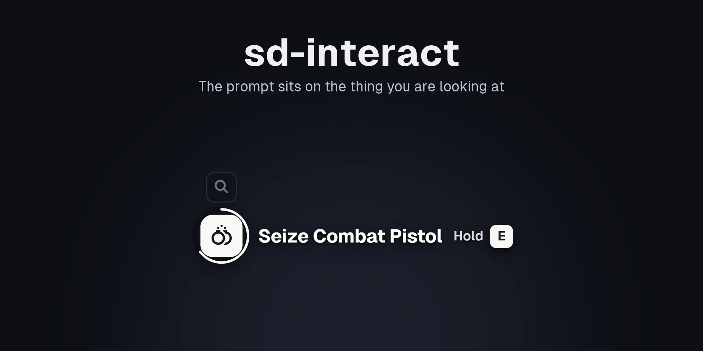
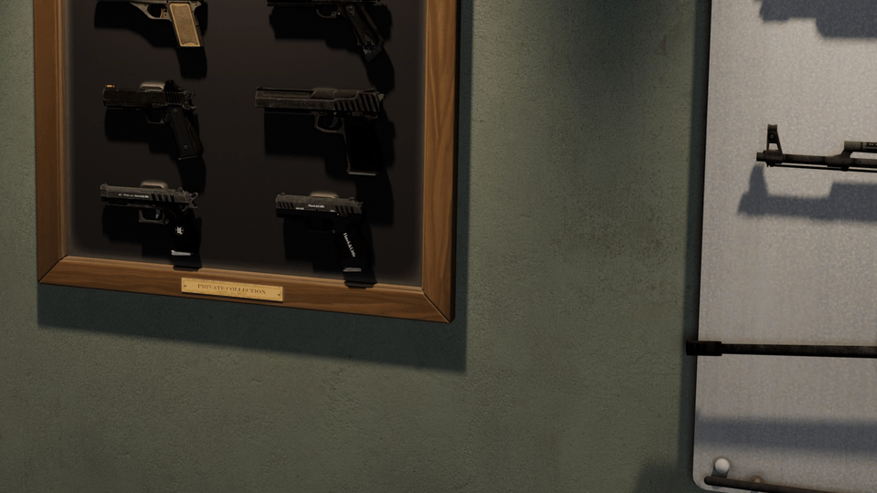
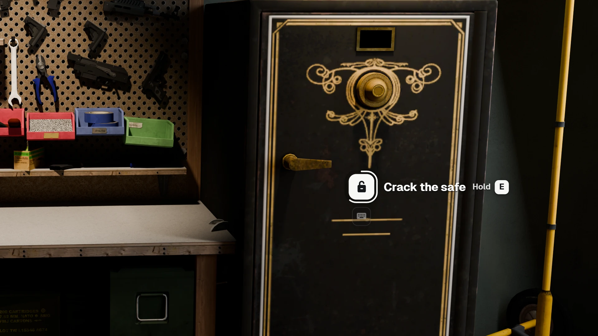
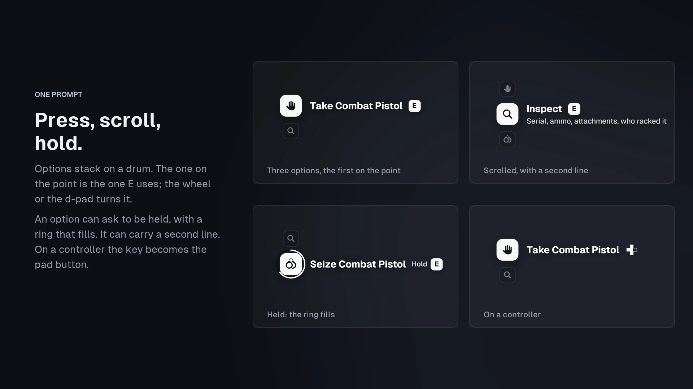
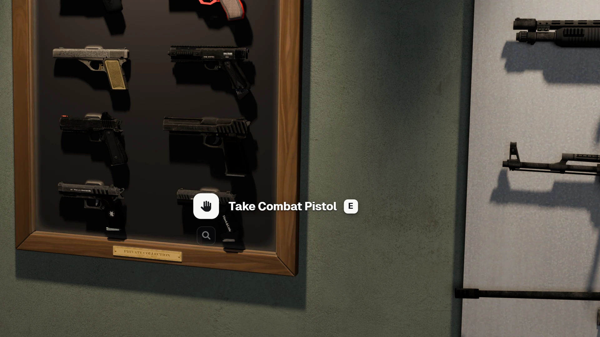

<div align="center">

# sd-interact



sd-interact puts the interaction on the thing itself. Look at something you can use and a small prompt opens on it: an icon on the spot, what it does, and the key that does it. Several options stack on a drum you scroll. Hold options fill a ring, and on a controller the key becomes the pad button. It has its own API, and it can also answer ox_target, qtarget and qb-target calls, so the scripts you already run use it without changing a line.

[](https://github.com/Samuels-Development/sd-interact)
[](https://discord.gg/FzPehMQaBQ)


[**Store**](https://fivem.samueldev.shop) · [**Discord**](https://discord.gg/FzPehMQaBQ)

**Works together:** **sd-interact** · [**sd-gunracks**](https://github.com/Samuels-Development/sd-gunracks)

</div>

---

## Support Me

If you're enjoying sd-interact and want to support my work, consider picking up a script from [Samuel's Development](https://fivem.samueldev.shop). Every purchase helps me keep building and improving free resources like this one.

## Preview

<p align="center"></p>

<p align="center"><sub>Recorded from the prompt page itself (the same page the game draws), over a rendered room.</sub></p>

## Screenshots

The rooms are rendered in Blender. The prompts are captured from the page and placed exactly where the game draws them: the tile on the point, at the size the default config draws at 4K. Click an image for the full 1920×1080 version.

<p align="center"><a href="docs/previews/01-on-anything.webp"></a></p>

<p align="center"><a href="docs/previews/02-states.webp"></a></p>

<p align="center"><a href="docs/previews/03-gun-racks.webp"></a></p>

---

## Highlights

- **On the thing, not on the screen.** The prompt is painted into the game's own frame at the point (an off-screen page drawn with `DrawSprite`). It stays pinned to the world with no lag, and it renders at the screen's own resolution, so its text stays sharp.
- **Quiet until you need it.** Only the point nearest the middle of the screen opens. Other points in range show as small dots, a ring once you're close enough, and dots that crowd together merge into one. A prompt behind a wall doesn't open.
- **Press, scroll, hold.** Options stack on a drum, and the one on the point is the one the key uses. An option can ask to be held, with a ring that fills and runs back if you let go. It can carry a second line, or change its label as things change ("Rack Assault Rifle").
- **Keyboard and controller.** Confirm, next and previous are FiveM key mappings (E and the wheel, the d-pad on a pad), so every player can rebind them in Settings > Key Bindings > FiveM. The prompt shows whichever device you're using.
- **Anything you can point at.** Coordinates, local or networked entities (on an offset or a bone), every entity of some models, or every vehicle, ped, object or player nearby.
- **A stand-in for the target you use.** Turned on, it answers `exports.ox_target`, `exports.qtarget` and `exports['qb-target']` with prompts: zones, entities, models, bones, global options, item, job and gang checks, and every way of handling an option.

## Compatibility

| Layer | Supported |
|---|---|
| Frameworks | Any. Job, gang and item checks read QBox, QBCore or ESX when one is running, and ox_inventory for items |
| Input | Keyboard and mouse, controller |
| Stands in for | ox_target (its 1.17 API), qtarget, qb-target (its 5.5 API) |
| Needs | [ox_lib](https://github.com/CommunityOx/ox_lib). Client only: no server script, no database |

## Installation

```cfg
ensure ox_lib
ensure sd-interact
```

Then go through `configs/client/`: distances, how the focused point is chosen, the default keys, the prompt's size, and the dots.

## Adding prompts

```lua
local id = exports['sd-interact']:addCoords(vec3(441.0, -978.0, 30.7), {
    options = {
        { label = 'Open the locker', icon = 'fa-solid fa-box-open', onSelect = function(data) ... end },
        { label = 'Search it', icon = 'search', hold = 1500, event = 'myres:search' },
    },
    distance = 7.0,          -- shows (as a dot) within this many metres
    interactDistance = 2.6,  -- opens within this many
})

exports['sd-interact']:addLocalEntity(entity, { options = { ... }, offset = vec3(0.0, -0.3, 0.9) })
exports['sd-interact']:addLocalEntity(vehicle, { options = { ... }, bone = 'boot' })
exports['sd-interact']:addEntity(netId, { options = { ... } })
exports['sd-interact']:addModel({ 'prop_atm_01', 'prop_atm_02' }, { options = { ... } })
exports['sd-interact']:addGlobalVehicle({ options = { ... } })   -- also addGlobalPed / Object / Player
```

Every `add*` returns the point's id. A point belongs to the resource that added it and goes when that resource stops.

```lua
exports['sd-interact']:update(id, { options = { ... }, interactDistance = 2.5 })
exports['sd-interact']:remove(id)
exports['sd-interact']:removeLocalEntity(entity, name?)   -- also removeEntity, removeModel, removeGlobal*
exports['sd-interact']:disable(true)    -- hide every prompt while your minigame runs; false brings them back
exports['sd-interact']:getFocus()       -- { id, entity, coords, option } of the open prompt, or nil
```

A point is measured to its middle, but a player reaches for its near side (a shopkeeper behind a counter, a car's door), so `Slack` in `configs/client/interact.lua` (0.75 m) is added to every distance a prompt is allowed at.

### Point fields

| Field | |
|---|---|
| `options` | the options, in order (a single option table also works) |
| `distance` | metres within which the point shows as a dot (default 7) |
| `interactDistance` | metres within which its prompt opens (default 2.6) |
| `offset` | from the entity, in its own space (entity points), or added to the coords |
| `bone` | a bone name or index: the prompt rides it (a door, a boot) |
| `lineOfSight` | `false` lets the prompt open through walls (default `true`) |
| `allowInVehicle` | `true` keeps it while the player sits in a vehicle |
| `groups` | jobs or gangs: `'police'`, `{ 'police', 'ambulance' }` or `{ police = 2 }` |
| `name` | for `remove*(…, name)` |

### Option fields

The same handler fields as an ox_target option, so option tables move over as they are.

| Field | |
|---|---|
| `label` | what it does, in sentence case: "Take Pump Shotgun" |
| `icon` | Font Awesome classes (`'fa-solid fa-gun'`, `'fas fa-box'`) or a Lucide icon name (`'phone'`) |
| `description` | a second, smaller line under the label |
| `hold` | milliseconds to hold the key instead of pressing it |
| `distance` | this option needs the player closer than the point's `interactDistance` |
| `groups` | as on the point, for this option |
| `canInteract(entity, coords, args, distance)` | return `false` to hide it; a second return value is the label to show now |
| `onSelect(data)` | `data = { id, name, entity, coords, distance, args }` |
| `export` | `'resource.exportName'`, called with `data` |
| `event` / `serverEvent` | triggered with `data` (the server gets the entity as its network id) |
| `command` | run with `ExecuteCommand` |
| `args` | passed through to `canInteract` and the handler |

## Replacing ox_target, qtarget or qb-target

Scripts written for a target resource can use prompts without being changed.

1. Name the ones to answer in your server.cfg, before `ensure sd-interact`:

   ```cfg
   setr sd_interact:replace "ox_target,qtarget"
   ```

2. Take the real resource out of your server. Two resources answering one export fight, so never run both.
3. Scripts that list it as a dependency need something by that name to start. Either uncomment its `provide` line in sd-interact's `fxmanifest.lua`, or add an empty stand-in resource with that name. With the stand-in, `GetResourceState('ox_target')` reports `started`, so scripts that look for ox_target before using it find it.

   ```lua
   -- resources/ox_target/fxmanifest.lua
   fx_version 'cerulean'
   game 'gta5'
   version '1.17.2'            -- the ox_target API sd-interact answers
   sd_interact_stand_in 'yes'  -- sd-interact recognises it and doesn't warn
   dependency 'sd-interact'
   ```

sd-interact then answers `exports.ox_target:addBoxZone(...)`, `exports['qb-target']:AddTargetModel(...)` and the rest:

- **Where prompts go.** Zones become a prompt at their middle. Entities, models and globals get a prompt on the entity (on its bones, for options with `bones` or `AddTargetBone`). Self targets (`addSelfTarget`) open on your own ped when you look down at it.
- **Checks.** `groups`, `items` and `anyItem`, `job`, `gang`, `item` and `citizenid` all keep working, and so does `canInteract`, called with each resource's own arguments.
- **Handlers.** Each one gets the data its own resource would give it. That covers `onSelect` and `action`, `export` (on the resource that added the option), `event` and `serverEvent`, `command`, and qb's `type = 'client' | 'server' | 'command' | 'qbcommand'`.
- **Removing.** Removal works by option name (ox) or label (qb), and the ox_target and qtarget layers keep their points apart.

### Known differences

- ox_target's `offset` without `absoluteOffset` is a fraction of the model's size; here it is metres.
- Submenus (`menuName` / `openMenu`) show flat, with the other options.
- qb-target's `job = 'all'`, `excludejob`, `jobType`, `excludejobType` and `excludegang` aren't read yet.
- `getTargetOptions()` with no entity answers for the open prompt, since there is no target eye.

## For developers

### The prompt page

The prompt is a React page in `web/`, drawn by the game as an off-screen page (a DUI). The built page ships in `web/build`.

```bash
cd web
npm ci
npm run dev     # then open http://localhost:5173/#mock: a scripted run of every state (#mock&step=0..4 freezes one)
npm run build   # what the game draws (web/build)
```

`#shot=<messages>` shows one state, given as the same JSON messages the game sends, for pictures like the ones above. `CANVAS` and `ANCHOR` in `web/src/Prompt.tsx` must match `Canvas` and `Anchor` in `configs/client/draw.lua`.

### Tests

`lua tests/run.lua` runs focus picking, the point registry, and the ox_target, qtarget and qb-target layers offline under stock Lua 5.4: option conversion, handler data, checks, removal and the self target.

## Licence

GPL-3.0. Fonts, icons and other third-party material are listed in [THIRD_PARTY_NOTICES.md](THIRD_PARTY_NOTICES.md).
